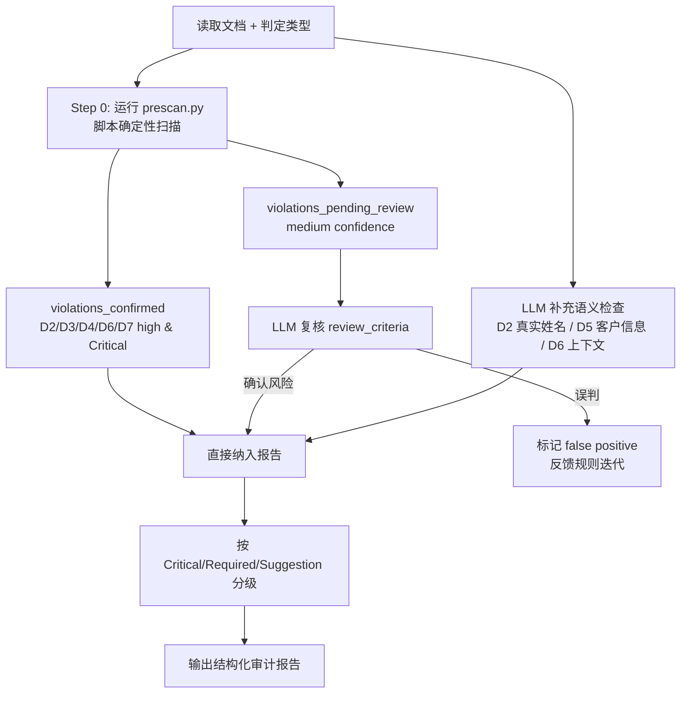

# 检查流程与使用方法

本文件包含 doc-security-sensitive-tester 的完整检查流程、报告格式、使用方法、失败处理策略和 Input / Output 定义。

## 一、完整检查流程

### 流程图



### 步骤说明

1. **Step 0：运行 prescan.py** — 对文档进行脚本确定性扫描，获取 violations_confirmed 与 violations_pending_review
2. **判定文档类型与发布范围** — 内部文档/对外文档，确定检查严格度（影响 medium 命中的复核标准）
3. **复核 pending_review** — LLM 根据 review_criteria 字段逐条判断（公网 IP 是否已授权、HTML 注释内容是否敏感等）
4. **LLM 补充扫描** — 检查脚本无法覆盖的语义级问题：
   - **D2** 真实姓名识别（中文/英文全名）
   - **D5** 客户名称/项目代号/局点地址（需企业知识）
   - **D6** 政治敏感词上下文判断
5. **合并结果** — 将 prescan 的 confirmed 结果与 LLM 复核/补充结果合并
6. **标记严重等级**：
   - **Critical** — 高危泄露：身份证号、银行卡号、密钥、PEM 私钥、连接串明文密码
   - **Required** — 明确的敏感信息泄露：内网 IP、客户名称、真实姓名、手机号等
   - **Suggestion** — 潜在风险：端口号、TODO 标记、追踪链接、歧视性用语等
7. **引用规则编号** — 发现问题时引用规则编号（D2-D7）
8. **验证脱敏** — 脱敏后的数据是否仍可被还原（如手机号脱敏后仍可猜测）

---

## 二、文档类型与检查严格度

| 文档类型 | 个人数据 | 明文密钥 | 公网信息 | 局点客户 | 敏感词 | 元数据 |
|----------|---------|---------|---------|---------|--------|--------|
| 对外公开文档 | critical | critical | critical | critical | required | required |
| 客户交付文档 | required | critical | required | required | required | suggestion |
| 内部技术文档 | suggestion | required | suggestion | suggestion | suggestion | suggestion |
| 仅限内部文档 | suggestion | required | 豁免 | 豁免 | suggestion | 豁免 |

---

## 三、报告格式

```
## 安全与敏感信息检查报告

**文件**：<路径>
**文档类型**：对外公开 / 客户交付 / 内部技术 / 仅限内部
**检查日期**：YYYY-MM-DD

### 风险汇总

| 维度 | Critical | Required | Suggestion | 问题数 |
|------|----------|----------|------------|--------|
| 个人数据与隐私 | X | X | X | X |
| 明文密钥与凭证 | X | X | X | X |
| 公网信息与内部地址 | X | X | X | X |
| 局点与客户信息 | X | X | X | X |
| 敏感词与合规风险 | X | X | X | X |
| 元数据与隐藏信息 | X | X | X | X |

### Critical问题（须立即处理）

| # | 位置 | 维度 | 描述 | 泄露内容类型 | 修复建议 | 规则编号 |
|---|------|------|------|-------------|----------|----------|
| 1 | file.md:23 | 明文密钥 | API Key明文暴露 | API Key | 替换为占位符 | 3.2 |

### Required问题（须修复后发布）

| # | 位置 | 维度 | 描述 | 泄露内容类型 | 修复建议 | 规则编号 |
|---|------|------|------|-------------|----------|----------|
| 2 | file.md:45 | 公网信息 | 内网IP地址泄露 | IP地址 | 替换为示例IP | 4.2 |

### Suggestion问题（建议优化）

| # | 位置 | 维度 | 描述 | 修复建议 | 规则编号 |
|---|------|------|------|----------|----------|
| 3 | file.md:67 | 元数据 | HTML注释含内部备注 | 删除注释 | 7.2 |
```

---

## 四、示例调用

- "检查此文档的敏感信息"
- "排查文档中的安全风险"
- "审查隐私合规"
- "检测明文密钥泄露"
- "扫描公网IP暴露"
- "检查客户信息是否脱敏"
- "验证文档脱敏质量"
- "检查敏感词"
- "文档安全审计"

---

## 五、基本使用流程

1. 指定要检查的文档路径
2. 指定文档类型（对外公开/客户交付/内部技术/仅限内部
3. 执行六大维度检查
4. 生成检查报告

---

## 六、与其他Skill配合使用

| 配合Skill | 场景 |
|-----------|------|
| 人阅读体验分析 | 安全检查通过后，检查人阅读体验质量 |
| 内容质量分析 | 安全检查通过后，检查GEO/SEO质量 |
| [中文错别字分析](../../typo/references/usage-guide.md) | 安全检查通过后，检查中文错别字 |
| 英文拼写分析 | 安全检查通过后，检查英文拼写 |

### 建议检查顺序

1. **安全检查（本Skill）** — 首先确保无敏感信息泄露
2. 内容质量检查 — 其次确保内容质量
3. 格式与拼写检查 — 最后确保文字规范

---

## 七、Input / Output 定义

```yaml
Input:
  path: string                # 文档路径（必填）
  docType: "public" | "customer" | "internal" | "restricted"  # 文档发布范围
  skipPrescan?: boolean       # 是否跳过脚本预扫描（默认 false）

Output:
  prescanResults:             # 脚本预扫描结果
    run: boolean              # 是否实际执行了 prescan.py
    scanned_files: number
    violations_confirmed: list      # 脚本 high confidence 命中
    violations_pending_review: list # 脚本 medium confidence 命中
  report:
    docType: string
    summary:                  # 风险汇总
      critical: number
      required: number
      suggestion: number
    issues: list              # 含 source 字段："prescan" | "llm"
```

---

## 八、Failure Strategy（失败处理策略）

| 场景 | 策略 |
|------|------|
| 文档无法读取/为空 | 报告错误并终止，提示确认路径 |
| 文档为纯英文/纯代码 | 仍执行扫描（密钥/IP/邮箱不分语言 |
| 文档超 10000 行 | 优先输出 Critical 级别命中 |
| references/ 无法加载 | 降级使用 SKILL.md 内置规则 |
| **prescan.py 不可执行（Python 缺失/脚本错误） | **降级为纯 LLM 扫描，报告中明确标注"⚠️ 脚本预扫描未执行，结果可能不完整"。安全场景需主动告警 |
| 脚本 high 命中与 LLM 判断冲突 | **以脚本为准**（安全场景宁可误报不漏报 |
| 脚本 medium 命中 LLM 复核否决 | 标记为 false positive，记录到 gotchas 用于规则迭代 |
| Luhn 校验通过但实际为示例号 | 标记为 medium 由 LLM 复核 |
| frontmatter 中的团队邮箱 | 标记为 medium 由 LLM 判断个人 vs 团队 |
