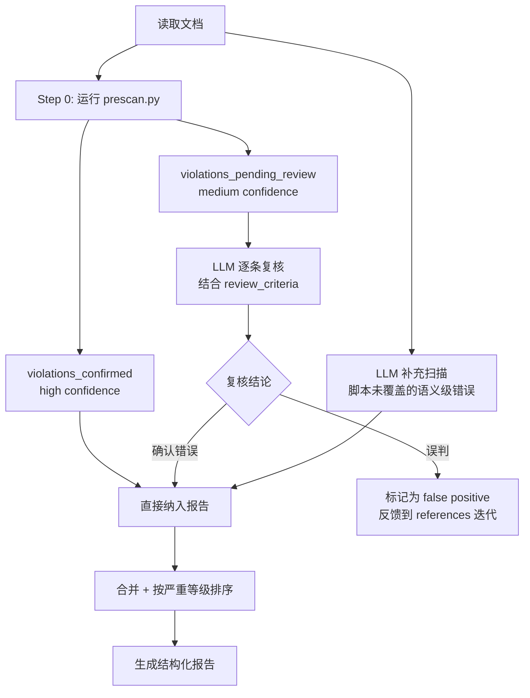

# 使用方法与报告格式

本文件包含详细的检查流程、报告格式、示例调用、输入输出定义和失败处理策略。

## 一、检查流程

### 流程图

```
读取文档 → Step 0: 运行 prescan.py → 获取 violations_confirmed (high) + violations_pending_review (medium)
                             ↓
                    LLM 逐条复核 medium 命中
                             ↓
                    LLM 补充扫描（脚本未覆盖的语义级错误）
                             ↓
                    合并 + 按严重等级排序
                             ↓
                    生成结构化报告
```



### 步骤说明

1. **Step 0：运行 prescan.py** — 对文档进行字典确定性扫描，获取 violations_confirmed 和 violations_pending_review
2. **判定文档语言类型** — 纯中文/中英混合
3. **确定术语基线** — 识别技术术语标准写法
4. **复核 pending_review** — LLM 根据 review_criteria 字段逐条判断 medium 命中是否为真实错别字
5. **LLM 补充扫描** — 检查 prescan 无法覆盖的语义级问题（如"的/地/得"的语法判断、"必需"是否为合法形容词等）
6. **合并结果** — 将 prescan 的 confirmed 结果与 LLM 发现合并
7. **标记严重等级**：
   - **required** — 明确错别字（如"按装"→"安装"）
   - **suggestion** — 风格建议（如"缺省"→"默认"）
8. **引用规则** — 引用对应规则编号

## 二、报告格式

```markdown
## 错别字检查报告

**文件**：<路径> **检查日期**：YYYY-MM-DD
**预扫描结果**：X 个 high confidence 命中，Y 个待复核

### 问题汇总
| 维度 | 级别 | 问题数 |
|------|------|--------|
| 同音字混淆 | 必需 | X |
| ... | ... | ... |
| 术语表述不一致 | 建议 | X |

### 问题列表
| # | 位置 | 维度 | 严重性 | 错误 | 修正 | 规则编号 | 来源 |
|---|------|------|--------|------|------|----------|------|
| 1 | 文件:行 | 同音字 | required | 按装 | 安装 | 2.4 | prescan |
| 2 | 文件:行 | 易混词 | required | 必需 | 必须 | 2.9.1 | llm |
```

## 三、示例调用

- "检查此文件的错别字""校对这篇中文文档"
- "审查文档中的同音字错误""检查技术术语拼写"
- "排查拼音输入法导致的错别字""检查词序颠倒/重复字/漏字"
- "检查术语表述一致性""检查文档内容重复"

## 四、输入输出定义

```yaml
Input:
  path: string                # 文档路径（必填）
  language?: "zh" | "mixed"   # 文档语言类型（默认自动检测）
  strictness?: "strict" | "normal"  # 检查严格度（默认 normal）
  skipPrescan?: boolean       # 是否跳过预扫描脚本（默认 false）

Output:
  prescanResults:             # 预扫描结果
    run: boolean              # 是否实际执行了 prescan.py
    violations_confirmed: list      # 脚本确定的 high confidence 命中
    violations_pending_review: list # 需 LLM 复核的 medium confidence 命中
  totalIssues: number
  summary: object             # 按维度汇总
  issues: object[]            # {line, dimension, severity, error, fix, ruleId, source}
                              # source 取值: "prescan" | "llm"
```

## 五、失败处理策略

| 场景 | 策略 |
|------|------|
| 文档无法读取/为空 | 报告错误，提示确认路径 |
| 文档为纯英文 | 提示仅适用于中文文档 |
| 对照表无法覆盖 | 标记为 suggestion，建议人工确认 |
| 文档超 10000 行 | 优先检查标题和首段 |
| references/ 无法加载 | 降级使用 SKILL.md 内置摘要表 |
| prescan.py 不可执行（Python 缺失/脚本错误） | 降级为纯 LLM 检查，报告中标注"预扫描未执行" |
| 脚本 high 命中与 LLM 判断冲突 | 以脚本为准（字典确定性匹配优先） |
| 脚本 medium 命中 LLM 复核后否决 | 标记为 false positive，记录到 gotchas 用于迭代字典 |
